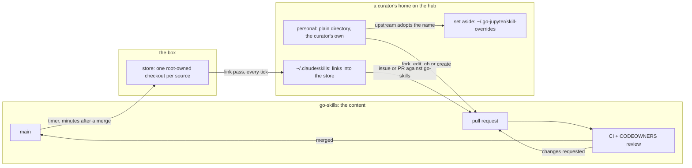

# go-jupyter

A reproducible **JupyterHub-on-EC2** deployment that gives each user an isolated
Unix account with [Claude Code](https://www.anthropic.com/claude-code) and
JupyterLab, seeded from a starter template. The Gene Ontology project uses it to
run **agentic biocuration** workshops — curators work with an AI agent in a
browser terminal — but nothing here is GO-specific by necessity: point it at your
own fork, domain, and templates and you have your own agent workshop box.

This repository is public and self-contained. It contains **no secrets**: every
credential is supplied out-of-band at deploy time (see [Secrets](#secrets)).

## Background

GO runs this as the **GO AI Hub**, a closed beta for GO curators at
<https://jupyter.geneontology.io> (GitHub login, allowlisted from GO's
`users.yaml`). Each curator gets a Unix account with JupyterLab, a terminal, and
Claude Code preloaded with GO-CAM curation skills: Noctua access through
barista, literature and protein lookups, GO-CAM best practice, and a save path
that submits finished models to
[`go-cam-drop-box`](https://github.com/geneontology/go-cam-drop-box) for review
and promotion into production Noctua.

The approach, the training modules, and the first four-hour workshop with 37
curators are described in Carbon, Moxon, Van Auken, Gaudet and Mungall,
*Agents for Everyone: A Workshop Framework for Building Agentic AI Capabilities
in a Distributed Curation Community* (arXiv:2608.27675,
<https://arxiv.org/abs/2608.27675>, August 2026). Its conclusion is the design
brief for this repo: remove technical barriers, introduce capabilities
gradually, and ground exercises in familiar curation tasks.

## Architecture

```
        Cloudflare / DNS (optional)
                 │
          :443   ▼
        ┌─────────────────── EC2 (Ubuntu 24.04) ───────────────────┐
        │  Caddy  ──TLS──►  JupyterHub (127.0.0.1:8000)             │
        │                     │ spawns a single-user server        │
        │                     ▼   per Unix account                 │
        │  /home/<user>/  ← seeded once from user-templates/<t>/    │
        │     └─ Claude Code (anthropic | vertex backend)          │
        └───────────────────────────────────────────────────────────┘
```

- **Terraform** (`terraform/`) provisions the instance in an existing VPC/subnet,
  an Elastic IP, a security group, an instance IAM role, and (in `direct`
  fronting) a Route53 A record.
- **cloud-init** (`terraform/user_data.sh.tpl`) installs the stack, clones this
  repo, and writes the hub config. Re-running it replaces the instance, so a
  `prevent_destroy` guard protects the users' home directories.
- **JupyterHub** (`jupyterhub_config.py`) authenticates users (PAM and/or GitHub
  OAuth), spawns a per-user server, and seeds each new home from a chosen
  template.
- **Caddy** terminates TLS using a wildcard cert bundle you supply from S3
  (`wildcard_cert_s3_uri`), fetched at boot via the instance IAM role so the
  private key never touches Terraform state. (Per-host Let's Encrypt is not
  wired in this version.)
- **Starter templates** (`user-templates/`) are plain files (skills, docs,
  dotfiles) copied into a user's home on first login. A systemd timer keeps the
  skills in sync with the repo.

## Deploy your own

Prerequisites: an AWS account with a VPC/subnet, an SSH keypair, a Route53 zone
you control, a wildcard TLS cert bundle (certbot tree, tar.gz) in an S3 bucket
you control, and an agent backend key (a Claude API key, or a GCP service
account for Vertex). `route53_zone_name` and `wildcard_cert_s3_uri` are required.
The VPC and subnet are found by their `Name` tags (`vpc_name_tag`,
`subnet_name_tag`, both default `default`); set them if yours differ.

```bash
cd terraform
cp terraform.tfvars.example terraform.tfvars   # then edit — see the comments in it
terraform init
terraform apply
```

Point `git_repo_ssh_url` at your own fork to serve your own skills and
templates. `terraform.tfvars`, state, and any `*-inventory` files are
gitignored.

## Curator access and workshop mode

Users log in over HTTPS (PAM accounts you seed, or GitHub OAuth) and land in a
JupyterLab with a terminal. Each gets a real Unix account on a shared host.

Who may sign in with GitHub comes from go-site's `metadata/users.yaml`: with
`allowlist_authorization` set (GO uses `go-ai-hub`), the entries whose
`authorizations.<key>.allow-login` is true; with it empty, every entry that has
a GitHub handle. `go-jupyter-refresh-allowlist` rebuilds the list hourly and
the hub reads it at every sign-in, so adding or removing someone is an edit to
`users.yaml` and nothing on the box. A removed person keeps their home and any
running server; their next sign-in is refused.

> **Workshop-mode tradeoff, stated plainly.** As shipped, the launcher and the
> seeded shell start Claude Code with `--dangerously-skip-permissions` (and the
> launcher additionally with `--trust-workspace`) so non-technical curators
> aren't stopped by per-action confirmation prompts, and the agent backend key
> is shared across users. This is appropriate only for a
> **controlled, time-boxed workshop on a disposable host with trusted
> participants**. For anything longer-lived, turn permission prompts back on
> (remove that flag in `user-templates/*/.bashrc` and
> `jupyter-data/jupyter_app_launcher/jp_app_launcher.yaml`) and give each user
> their own backend credential. Hardening this into a safe default is on the
> roadmap.

## Secrets

Nothing sensitive lives in this repo. Credentials are referenced by path in your
gitignored `terraform.tfvars`, read at plan time, and delivered to the box via
cloud-init (never committed, never in the repo's history):

- agent backend key → `/etc/anthropic-api-key` or `/etc/gcp-credentials.json`
- GitHub deploy key (only if your source repo is private) → baked into user_data
- optional NCBI E-utilities key → `NCBI_API_KEY` in `/etc/default/go-jupyter`
- JupyterHub auth-state key (`JUPYTERHUB_CRYPT_KEY`) → generated on the box at
  first boot into `/etc/jupyterhub/jupyterhub.env`; not an operator secret. It
  encrypts the GitHub OAuth token the hub keeps between sign-in and spawn so
  that `gh` can be logged in with it (see the operating notes).

## Operating notes

- **A hub restart ends every running single-user server**, including open
  terminals and any `claude` session inside them (files on disk are safe). The
  runtime helpers `go-jupyter-add-user` and `go-jupyter-remove-user` both end in
  a restart, so run them between sessions, not during one.
- **Each user's server is a transient systemd unit with a private `/tmp`
  (since #95, October 2026).** `jupyterhub-systemdspawner` with `isolate_tmp`
  starts every server as `jupyter-<user>-singleuser` under `PrivateTmp`, after
  a request file one curator's session had left at `/tmp/req.json` was read and
  posted to noctua-dev by another curator's session. What follows from it:
  - A session's `/tmp` and `/var/tmp` are its own and are emptied when the
    server stops (a hub restart, or the stop button on the hub's control
    panel; logging out does not stop a server); the template `CLAUDE.md`
    tells Claude to keep anything that matters under the home. The host's
    `/tmp` keeps the old leftovers; sessions cannot see them, and nothing
    deletes them.
  - A user's server log is `journalctl -u jupyter-<user>-singleuser`, no longer
    the hub's journal; `systemctl list-units 'jupyter-*'` lists who is up.
  - The units run with `NoNewPrivileges`, so nothing setuid works inside a
    session (`sudo`, `su`, `passwd`); no curator has sudo anyway.
  - The hub still stops every unit as it shuts down (`cleanup_servers`), so a
    restart ends everything as before. A hub that is killed rather than
    stopped leaves the units running: `systemctl stop 'jupyter-*-singleuser'`.
  - Verify after the deploying restart, once someone has spawned:
    `systemctl show jupyter-<user>-singleuser -p PrivateTmp` prints `yes`, and
    `ls /tmp/systemd-private-*-jupyter-<user>-singleuser-*/tmp` (as root) is
    that session's private directory.
  - Deploying it needs nothing by hand: `sudo go-jupyter-update` runs `uv sync`
    (which installs the spawner package from `uv.lock`) and restarts the hub.
    Pick an idle window (next bullet) and merge the `news/` entry with it.
- **Idle is not the same as absent.** Curators leave JupyterLab tabs and
  `claude` processes running for days. To know whether anyone is *working*,
  read the timestamp of the last `user`/`assistant` entry in each
  `~<user>/.claude/projects/*/*.jsonl` (the files are append-only). Two signals
  that look right but are not: those files' mtimes, which idle `claude`
  processes bump every few minutes, and the hub's `last_activity`, which an
  open browser tab keeps fresh by polling.
- **Replacing the box (blue/green).** Bring up a second stack from a separate
  Terraform state with the same `fronting` and hostname, verify it, then on the
  new box run `go-jupyter-migrate <old-host>` (see the script header for the
  agent-forwarding form that never copies a key). The sequence that worked for
  the 2026-09-22 cutover, in order:
  1. Full `go-jupyter-migrate` while the old hub is still up. Re-running it
     later is safe: it skips accounts that already exist and adds any created
     on the old box since.
  2. In a quiet window, `systemctl stop jupyterhub` on the old box. The hub
     stops every `jupyter-<user>-singleuser` unit as it shuts down, and each
     `claude` process runs inside its unit, so this ends them all and nothing
     can change there afterwards; `systemctl list-units 'jupyter-*'` must come
     back empty before the next step.
  3. `go-jupyter-migrate <old-host>` again for the final delta, then
     `go-jupyter-refresh-user --all` on the new box: the rsync brings the old
     box's copies of the template-owned files (skills, `CLAUDE.md`, `.bashrc`)
     over what first-login seeding put there, and the skills-sync timer will
     not correct that because it only acts when `main` moves.
  4. Restart the new hub. Repoint the hostname at the new EIP: the Route53
     record via Terraform for `fronting = "direct"`, the CDN-side origin record
     by hand for `fronting = "cloudflare"`. Verify with a tagged request through
     the edge (`/hub/login?probe=…`) and grep the new hub's journal for it.
  5. Destroy the old stack from a saved plan (`terraform plan -destroy -out=…`,
     then `terraform apply <file>`) so the destroy count is visible before
     anything changes.
  Do not run a blanket rsync from the old box after the repoint: `rsync -a`
  copies whatever differs, so old copies would overwrite files written on the
  new box since. Copy per user, on request, if someone kept working on the old
  box through a still-open WebSocket.
- **Where skills come from, and how changes reach curators (since 2026-10-14,
  #87; per-home clones from 2026-09-28 to then).** Skills live in their own
  repositories, listed one per line in `skill-sources.txt`
  (geneontology/go-skills first, geneontology/go-ontology second). Each source
  is checked out once on the box, root-owned, under
  `/var/lib/go-jupyter/skill-sources/<repo>` (the store), and every seeded
  account's `~/.claude/skills/<skill>` is a symlink into it. Nobody edits the
  store: a skill changes by a pull request to its repository, and the merge is
  in every home within minutes. A source can be checked out blobless and
  sparse (`sparse=`: go-ontology comes as its skills plus `src/ontology`,
  about 210 MB instead of gigabytes), can leave skills out (`exclude=`: the
  two that need the ODK Docker image), and can be a `workspace` (go-ontology):
  each home then also keeps a per-user clone for editing the repository
  itself, with its skills still linked to the store. Two sources offering the
  same skill name: the first listed wins, the other is logged. Everything for
  everyone: no per-template list. The timer (`go-jupyter-sync-skills`) checks
  each source's ref with one `ls-remote` per tick; when it moved (or this
  repo's templates or sources file changed, or the store is incomplete, or
  `--force`) it fetches the store (`go-jupyter-link-skills --update-store`)
  and fast-forwards clean workspace clones. The per-home link pass
  (`go-jupyter-link-skills <user>`) runs on every tick and never fetches:
  links are made, retargeted and, for skills gone upstream, removed; a real
  directory, file or foreign link under a canonical name is moved to
  `~/.go-jupyter/skill-overrides/<timestamp>/` with a README and a one-time
  notice at the next login; a real directory under any other name is the
  curator's own skill and is never touched (experimentation is wanted; the
  pull request to go-skills is the way to share it). `exclude=` withholds the
  personal link only; inside a workspace clone the skill is still a project
  skill. Claude Code follows the links and watches the targets, so a running
  session picks up new upstream text on its next invoke of the skill. News
  still mirrors from the template (`news/`) and shows at the next session
  start. The template `CLAUDE.md`, `README.md`, `.bashrc` and `.mcp.json`
  still reach existing homes only via `sudo go-jupyter-refresh-user --all`
  (dry-run first). Verify by looking at the homes: `ls -l /home/*/.claude/skills`
  shows links into `/var/lib/go-jupyter/skill-sources/`, and
  `journalctl -t go-jupyter-link-skills` shows what was set aside or left in
  place. When a change touches both `go-jupyter-link-skills` and
  `skill-sources.txt`, install the helper on the box before merging: the timer
  runs the installed helper against the merged file within minutes.
  Skills that a template still carries as real directories (only the tutorial's
  workshop-specific `exercise` and `recap`, kept out of go-skills by decision)
  are mirrored per skill directory, never with a whole-directory delete. When
  go-skills starts serving a skill a template also carries, the next link pass
  sets each home's copy aside and links the canonical one; delete the template
  copy from the repo afterwards. The seven GO-CAM skills left the templates
  this way on 2026-09-28, under the earlier byte-identical rule.
- **The drop-box save is a two-file export from noctua-dev (since 2026-09-24).**
  The contract itself lives in
  [`geneontology/go-cam-drop-box`](https://github.com/geneontology/go-cam-drop-box)
  (README, `CLAUDE.md`, `PROMOTIONS.md`); the `save-to-drop-box` skill here must
  match it. What an operator of this box needs to know: curators build models on
  noctua-dev through barista; the gocam-py YAML is derived on the box from the
  minerva JSON returned by the m3 `get` operation, and the Turtle that actually
  enters production comes from the m3 `export` operation, both taken from the
  same **stored** state of the dev model under its dev-minted id. Storing is not
  automatic: of the first 22 submissions, 9 had never been stored and were gone
  from noctua-dev after its next restart, so no Turtle existed for them. Merged
  pairs are copied into `noctua-models` at a Noctua maintenance outage with the
  id unchanged (first batch: 12 models, 2026-09-24).
- **Signing in with GitHub also signs in `gh` (since 2026-09-29).** The hub
  requests `repo`, `read:org` and `user:email`, stores the token as encrypted
  auth state, and at every spawn runs `gh auth login --with-token` as the user
  when gh is not already logged in (and `~/.go-jupyter/no-gh-token` is absent).
  `/etc/gitconfig` makes gh git's credential helper, and the first-login seed
  sets the commit identity from the GitHub profile, so `git push` and `gh pr
  create` work with no further steps. Manual `gh auth login` remains the
  fallback (PAM accounts, revoked tokens). Rolling the scopes forward makes
  GitHub re-ask every user for consent at their next sign-in; announce it in
  `news/`.
- **Adding or removing a curator (since 2026-10-12).** One edit in go-site
  `metadata/users.yaml`: a `go-ai-hub` block under the person's
  `authorizations` (`allow-login: true`; `allow-admin: true` for drop-box
  maintainers). The hub follows within the hour (`sudo
  go-jupyter-refresh-allowlist` to apply at once) and the drop box's CI check
  reads the file live. Two things do not follow by themselves: the drop-box
  team that gives write access (`gh api -X PUT
  orgs/geneontology/teams/go-ai-hub/memberships/<login> -f role=member`, and
  `-X DELETE` to remove; the operator reconciles it by hand on each
  `users.yaml` change, by decision of 2026-10-13, because an automated sync
  would need an org-admin credential stored somewhere), and a removed
  person's existing hub session, which
  lasts until their cookie expires (14 days from sign-in) or they log out;
  rotating `/opt/go-jupyter/jupyterhub_cookie_secret` and restarting ends
  every session at once. Removal keeps the home.
- **Claude Code's version is not pinned.** Cloud-init installs the current npm
  release at first boot; after that `go-jupyter-update-claude.timer` moves it
  (hourly check, newest release at least two days old, only while no session is
  mid-turn; `touch /etc/go-jupyter/hold-claude` freezes it, see `scripts/`).
  Because sessions run on the `opus` and `sonnet` model aliases, this is also how
  curators reach newer models.
- **Port 8000 is not loopback-only.** `jupyterhub_config.py` sets no
  `bind_url`, so the proxy listens on all interfaces; only the security group
  (80/443/22) keeps it off the internet. Caddy reaches it at `127.0.0.1:8000`,
  so binding it to loopback is a safe hardening if you tighten further.

## How a skill change flows

The box owns no skill text. It owns the arrows that move skills between the
source repositories and each curator's home; everything inside the go-skills
box below (writing, proposing, reviewing, merging) is go-skills' own, and the
same applies to go-ontology for its skills.



Facts the picture leaves out:

- The store is `/var/lib/go-jupyter/skill-sources/<repo>`. It is fetched when a
  source's ref moves (one `ls-remote` per source per tick) or on
  `go-jupyter-sync-skills --force`. The per-home link pass runs on every tick
  and never fetches the store (workspace clones are fetched only on a tick
  where their ref moved), so a link that was removed or replaced is back
  within about five minutes. A quiet tick logs nothing; the steady-state lines
  (personal skills, clones left in place, holds) appear only on full runs.
- Nobody can edit the store. A copy in `~/.claude/skills` under a canonical
  name, whatever it is, is moved to `~/.go-jupyter/skill-overrides/<timestamp>/`
  with a README and announced at the next login. Nothing is deleted.
- A plain directory under a name no source provides is the curator's own skill.
  The helpers never touch it; the login banner names it and points at the
  pull-request path. Experimentation is wanted; the canonical set is go-skills
  (kltm, 2026-10-14, #87).
- go-ontology is a `workspace` source: each home keeps a clone of it for editing
  the ontology (branches, pull requests to go-ontology). Its skills still link
  to the store. The clone fast-forwards on a tick where its ref moved, when it
  is on `master` with no modified tracked files; untracked files do not block.
- The per-home `~/go-skills` clones of the previous model were retired on
  2026-10-14: an untouched clone moved to `~/.go-jupyter/retired/`, one with
  work on it was left in place and logged for the operator.
- `~/.go-jupyter/hold-skills` in a home makes every run skip that account.
- The timer has only monotonic triggers (`OnBootSec`, `OnUnitActiveSec`).
  After `systemctl disable --now` and `enable --now` it shows no next elapse
  until its service has run once: `systemctl start go-jupyter-sync-skills.service`
  (a quiet run logs nothing), then `systemctl list-timers` shows the next tick
  (seen 2026-10-15).
- A skill deleted or excluded upstream loses its link at the next pass.
- `exclude=` on a source withholds the personal link only; a session started
  inside a workspace clone still sees the skill as a project skill. Likewise any
  repository a curator clones that has `.claude/skills/` provides those skills
  to sessions started inside it, and to that curator only.
- The return half of the loop is the curator's, with the agent's help: an
  issue against go-skills, or a pull request from a fork. Proposals derived
  from traces (#72), the feedback command (#25) and usage observation (#36)
  are open.

## Repo layout

| Path | What |
|---|---|
| `terraform/` | AWS provisioning (instance, EIP, SG, IAM, DNS) |
| `jupyterhub_config.py` | Hub auth, spawner, per-user env and home seeding |
| `user-templates/` | Starter homes (skills, docs, dotfiles) seeded per user |
| `scripts/` | Boot/runtime helpers (skills sync, Claude Code updater, user add/refresh/migrate) |
| `systemd/` | Units for the hub, the skills-sync timer and the Claude Code update timer |
| `justfile` | Common operator commands |

## License

See `LICENSE`.
